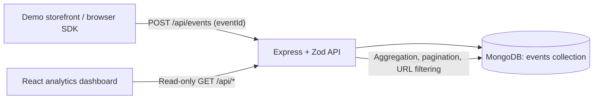

# InsightTrack

InsightTrack is a small full-stack web analytics application for exploring shopper journeys and click activity. A browser SDK records page views and clicks from the demo storefront, an Express API validates and stores events in MongoDB, and a React dashboard presents overview metrics, page performance, sessions, timelines, and click heatmaps.

## Architecture



## Features

- Browser SDK tracks initial page loads, SPA history changes, browser back/forward navigation, and eligible link/button clicks.
- Stable per-tab anonymous session IDs, Do Not Track support, sensitive URL query redaction, and document-relative click coordinates with viewport size, scroll offsets, document size, and device pixel ratio metadata.
- Event IDs with a MongoDB unique index make repeated submissions of the same event idempotent. The SDK does not automatically retry failed event POSTs.
- MongoDB-backed overview and trend aggregations, page breakdown, date presets, searchable/sortable/paginated sessions, ordered event timelines, and per-page click heatmaps.
- Dashboard routes are excluded from event collection. Analytics reads do not create events.
- Loading, empty, validation, database, and request-error states.

## Tech stack

| Layer | Technology |
|---|---|
| Frontend | React 18, Vite, TypeScript, React Router, Tailwind CSS, Recharts |
| Backend | Node.js, Express, TypeScript, Zod, Helmet, express-rate-limit |
| Database | MongoDB with Mongoose |
| SDK | Standalone browser JavaScript |
| Tests | Vitest, Testing Library, Supertest |

## Prerequisites

- Node.js 20 or newer and npm
- MongoDB running locally or a MongoDB connection URI

## Local setup

From the repository root:

```powershell
npm install
Copy-Item backend\.env.example backend\.env
Copy-Item frontend\.env.example frontend\.env
npm run dev
```

The frontend is served at `http://localhost:5173`; the API is served at `http://localhost:5000`. Start MongoDB before starting the backend. `backend/.env` is loaded from the backend workspace and `frontend/.env` is loaded by Vite.

### Environment variables

`backend/.env.example`:

| Variable | Default | Purpose |
|---|---|---|
| `PORT` | `5000` | API listen port |
| `MONGODB_URI` | `mongodb://127.0.0.1:27017/insighttrack` | MongoDB connection |
| `NODE_ENV` | `development` | Runtime mode (`development`, `test`, or `production`) |
| `FRONTEND_ORIGIN` | `http://localhost:5173` | Allowed browser origin for CORS |

`frontend/.env.example`:

| Variable | Default | Purpose |
|---|---|---|
| `VITE_API_URL` | `http://localhost:5000/api` | API base URL |

The backend validates the port, MongoDB URI scheme, runtime mode, and frontend origin at startup. Do not commit `.env` files or production credentials.

## Demo walkthrough

1. Open `/store` and choose **Explore products**.
2. Open a product, click **Add to cart**, and visit the cart. Each page navigation and eligible click is recorded once.
3. Open **Overview** to inspect database-derived KPIs, the event/page-view trend, page breakdown, and heatmap. Choose Home, Product Listing, or Cart in the heatmap selector; scroll the actual page preview to inspect click positions.
4. Open **Sessions**, search or sort the session list, then choose **View** to see its chronological event timeline.
5. Refresh either dashboard view. Dashboard reads do not create analytics records.

The dashboard itself is intentionally excluded from tracking. The heatmap preview uses the real same-origin storefront page with a preview query flag that disables tracking inside the embedded page.

## API

All API paths are under `/api`. Successful responses use JSON and analytics GET responses are marked `Cache-Control: no-store`.

| Method and path | Purpose |
|---|---|
| `POST /events` | Validate and persist a page view or click |
| `GET /analytics/overview` | Totals, CTR, and daily trend |
| `GET /pages` | Page views and clicks grouped by canonical page URL |
| `GET /sessions` | Paginated session summaries; supports search, sort, and date filters |
| `GET /sessions/:sessionId/events` | Chronological, paginated session events |
| `GET /heatmap` | Click coordinates for a selected page; optional paired `viewportWidth` and `viewportHeight` filters |
| `GET /health` | API and MongoDB connection status |

The event payload includes `eventId` (UUID), `websiteId`, `sessionId`, `eventType` (`page_view` or `click`), absolute HTTP(S) `pageUrl`, and ISO timestamp. Click `clickX`/`clickY` are document-relative CSS pixels (`pageX`/`pageY`), not device pixels. Clicks also include `coordinateMode: "document"`, viewport and document dimensions, `scrollX`/`scrollY`, and `devicePixelRatio`. The SDK does not multiply CSS coordinates by device pixel ratio; scroll offsets are diagnostic metadata because page coordinates already include scrolling. The API rejects missing, non-finite, zero-dimension, and out-of-document click coordinates. A repeated `(websiteId, eventId)` returns success with `duplicate: true` and is not inserted again. Older clients may omit `eventId`; new integrations should always send it.

The heatmap response includes only valid clicks for the selected canonical page and one viewport-size cohort (the most common cohort by default). It returns the available viewport breakdown, click and distinct-session counts, and an invalid-coordinate exclusion count. The frontend scales the live same-origin full-page preview to preserve aspect ratio and lets the user select another viewport cohort. Fragment identifiers are omitted; meaningful query parameters and their order are preserved, while sensitive query-key values are redacted consistently in both SDK and backend URL canonicalization. Trailing slashes are normalized except at the origin root.

Analytics endpoints accept optional ISO-8601 `from` and `to` timestamps. The dashboard's 7- and 30-day presets use UTC day boundaries consistently across overview, page, heatmap, session, and journey queries. Sessions are distinct `(websiteId, sessionId)` pairs; unique pages are distinct `(websiteId, canonical pageUrl)` pairs within the selected date range. CTR is `clicks / pageViews * 100`, or zero when there are no page views.

## Database model

Events are stored in MongoDB's `events` collection. Each document contains:

| Field | Meaning |
|---|---|
| `eventId` | Optional UUID idempotency key; unique with `websiteId` when present |
| `websiteId`, `sessionId` | Analytics site and anonymous browsing session |
| `eventType` | `page_view` or `click` |
| `pageUrl`, `timestamp` | Canonical absolute URL and event time |
| `clickX`, `clickY`, `coordinateMode` | Document-relative CSS-pixel point and explicit `"document"` coordinate convention |
| `viewportWidth`, `viewportHeight` | Browser viewport dimensions at the click; used for heatmap cohorts |
| `documentWidth`, `documentHeight` | Page dimensions used to normalize full-page heatmap coordinates |
| `scrollX`, `scrollY` | Scroll offsets when the click occurred; retained to explain document-relative coordinates |
| `devicePixelRatio` | Device scale metadata; coordinates remain CSS pixels |
| `elementTag` | Clicked element type; no text or form value is collected |

Indexes support website/session/time queries, website/page/type/time heatmaps, website/type/time analytics, and unique event idempotency. Mongoose manages index creation; production deployments should ensure index builds are completed before accepting ingestion.

## Quality checks

```powershell
npm test
npm run build
```

The repository does not currently configure a standalone lint script. The production build runs TypeScript project checks for the frontend and TypeScript compilation for the backend.

## Screenshots

No screenshots are committed yet. Capture the Overview, Sessions, Journey, and Heatmap views from a locally running instance and add them here when available; do not use fabricated or mock analytics screenshots.

## Deployment

No hosted deployment is configured. To deploy, build the frontend with `npm run build --workspace frontend` and serve its `frontend/dist` as a single-page application with history fallback. Build the API with `npm run build --workspace backend`, run it with `npm start --workspace backend`, and provide a reachable MongoDB URI, API port, `FRONTEND_ORIGIN`, and frontend `VITE_API_URL` at build time. Restrict CORS to the deployed frontend origin and use HTTPS for both services. Keep credentials in the hosting provider's secret/environment configuration.

## Assumptions and limitations

- A session is scoped to a browser tab using `sessionStorage` with a cookie fallback. It is anonymous and is not a unique-person identity.
- Events are append-only. The application does not delete, merge, or automatically clean historical events.
- Existing records created before `eventId` was added are not retroactively deduplicated. To investigate possible historical duplicates, export/read-only aggregate records grouped by `websiteId`, `sessionId`, `eventType`, canonical `pageUrl`, and a narrow timestamp/coordinate window; review candidates manually before any backup-backed, explicitly approved cleanup. Identical clicks can be legitimate, so these fields cannot prove duplication.
- Heatmaps visualize document-relative normalized points over a live page preview rendered at one selected viewport size. They are not historical screenshots; content, responsive styling, fonts, or layout changes since a click can still affect visual alignment. Viewport cohorts are kept separate, while different document heights within one viewport cohort are normalized to the current preview height.
- Date aggregation and date presets use UTC; displayed timestamps use the browser's local timezone.
- `npm run dev` requires a working MongoDB service. API startup fails rather than silently switching to an in-memory or mock database.
